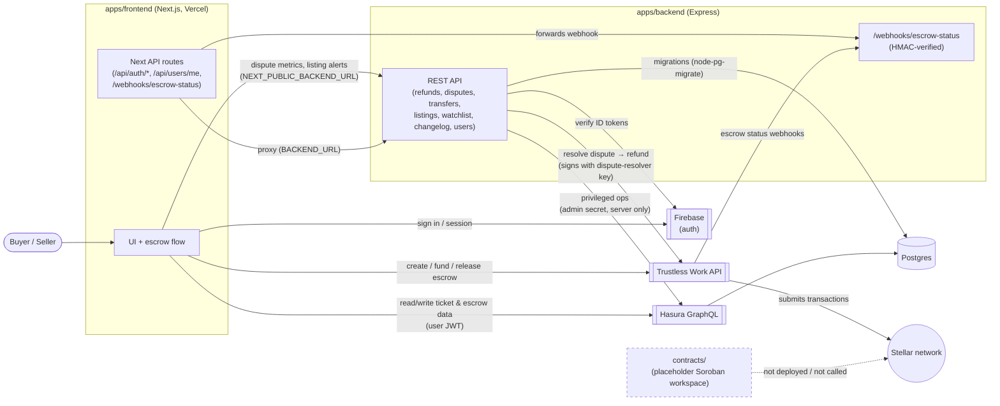

# Architecture

This diagram covers every external service the TrueStub apps talk to.
`apps/frontend` (Next.js) and `apps/backend` (Express) both do real work.
`contracts/` is still a placeholder.

_Last verified against the code: 2026-10-18. An earlier version of this page
described `apps/backend` as an unwired scaffold. It hasn't been one for a
while._

## Reading the diagram

- **The frontend** still does most user-facing work directly: Firebase for
  sign-in, Hasura for data (with the user's Firebase JWT), and Trustless
  Work for creating, funding and releasing escrows.
- **The backend** handles the operations that need a server-held secret or
  server-side enforcement:
  - Refunds: it signs the Trustless Work dispute resolution with the
    platform's dispute-resolver key.
  - Disputes, ownership transfers, and the audit changelog.
  - Privileged Hasura writes made with the admin secret.
  - Receiving Trustless Work's escrow-status webhooks.

  The frontend reaches it in two ways: through its own Next API routes,
  which proxy to `BACKEND_URL`, and directly from the browser through
  `NEXT_PUBLIC_BACKEND_URL`.
- **Postgres**: the backend's SQL migrations in
  `apps/backend/src/db/migrations/` own some tables; Hasura manages the rest.
  See [`DATABASE.md`](DATABASE.md).
- **Not everything in the backend is durable yet.** Refund claims, dispute
  state and the changelog are kept in memory. See
  [`DATABASE.md`](DATABASE.md#service-ownership) and
  [`RUNBOOKS.md`](RUNBOOKS.md).
- `docker-compose.yml` brings up Postgres, Hasura and the backend locally.
- **`contracts/`** is still a placeholder (`hello-world`). TrueStub's escrow
  runs entirely on Trustless Work's hosted contracts.

## Services at a glance

| Service | Role | Called by |
| --- | --- | --- |
| Firebase | User authentication; backend verifies ID tokens with Firebase Admin | frontend, backend |
| Hasura (+ Postgres) | Ticket, listing, escrow and user data over GraphQL | frontend (user JWT), backend (admin secret) |
| Postgres (direct) | Schema migrations | backend |
| Trustless Work API | Escrow create/fund/release (frontend); dispute resolution / refunds and escrow status webhooks (backend) | frontend, backend |
| Stellar network | Ledger Trustless Work settles on | via Trustless Work only |
| `apps/backend` | Refunds, disputes, transfers, webhooks, changelog, listings, watchlist, user sync | frontend |
| `contracts/` | Future custom Soroban contracts | nothing (placeholder) |
